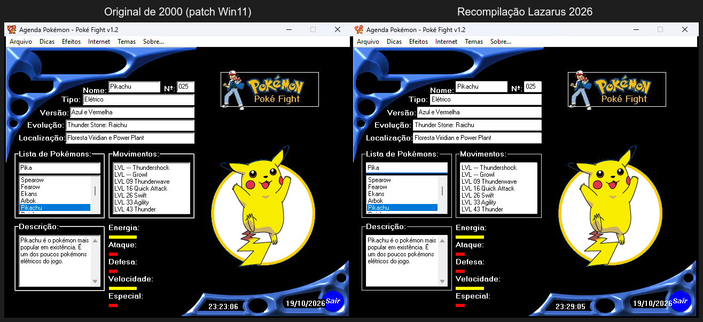
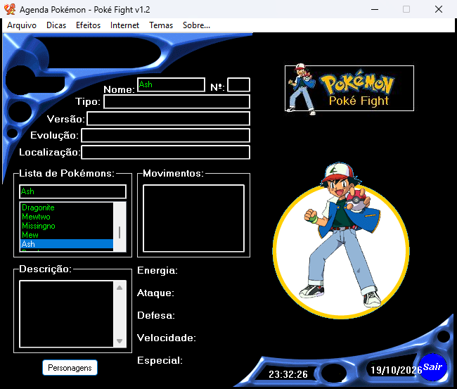

**Português** · [English](README.en.md)

# Agenda Pokémon — Poké Fight v1.2 (2000) · preservação

Uma Pokédex brasileira feita por fãs em **Delphi 3**, de janeiro de 2000, que não
funcionava mais desde o Windows 7 64 bits. Este repositório guarda o pacote
original sem alterações, uma **versão original com patch que roda no Windows 10/11**,
a **engenharia reversa completa** e uma **recompilação em Lazarus/Free Pascal**
feita a partir dela.



## Como usar

| Quero... | Use |
|---|---|
| Rodar o **programa original** de 2000 | [`legacy/win11/`](legacy/win11): abra `PokéFight1.2-win11.exe`. Na primeira execução ele extrai as imagens para `data\` |
| Rodar a **recompilação** | `.\build.ps1` gera `dist\PokeFight-Lazarus\PokeFight.exe` (ou baixe da Release) |
| Ver o pacote **exatamente como era** | [`legacy/original/`](legacy/original) (não roda em Windows 64 bits) |
| Entender **como o programa funciona** | [`analysis/README.md`](analysis/README.md) |

## Por que parou de funcionar

O programa em si (32 bits) até abre no Windows 11. O problema estava no "instalador":

1. Na primeira execução, o EXE chamava `press.com` e `img.com`, dois arquivos `.BAT`
   compilados com **BAT2EXEC** (programas DOS de 16 bits). Eles usavam o `Gym.com`
   (o **PKUNZJR** da PKWARE renomeado) para descompactar `DATA.GYM` e `IMG.GYM`, que são
   ZIPs renomeados.
2. O Windows de 64 bits não tem subsistema de 16 bits (NTVDM). Por isso aparecia
   **"Aplicativo de 16 bits sem suporte"** e as imagens nunca eram extraídas.
3. O destino era `C:\windows\data\`, que hoje exige permissão de administrador.

Detalhes e a correção: [`docs/LEGADO-WIN11.md`](docs/LEGADO-WIN11.md).

## O que tem aqui

```
legacy/original/   pacote original intocado (EXE, .GYM, .COM, 158 GIFs)
legacy/win11/      EXE original com patch + extrator nativo no lugar dos .COM de 16 bits
analysis/          engenharia reversa: relatório, 155 funções decompiladas, 14 forms (DFM),
                   dados extraídos (JSON/CSV), evidências do REA/Ghidra
src/               recompilação em Lazarus (Object Pascal, compatível com o original)
assets/ui/         imagens da interface extraídas dos forms do EXE
tools/             scripts que regeneram tudo a partir do EXE original
docs/              guias (docs/en em inglês) e capturas de tela
build.ps1          compila e monta dist/
```

## A recompilação

Feita **a partir da engenharia reversa**, não reescrita do zero. Ela mantém:

* **o layout**: os 8 forms foram convertidos automaticamente dos DFMs embutidos no EXE
  (`tools/dfm2lfm.py`), com as mesmas posições, fontes, menus, atalhos e nomes de componentes;
* **os dados**: as 158 entradas saem das cadeias de `if` decompiladas e foram conferidas
  entre os dois handlers do original, com 0 diferenças;
* **o comportamento**: cada handler traz o endereço da função original
  (ex.: `// 0x4b9df4`) para conferir com `analysis/decompilado/`. As esquisitices
  também foram mantidas: o aviso "anti-cópia" do PrintScreen, o "Atualizar Agenda"
  falso, a busca que anima as barras mesmo com Efeitos desligado…

Mudanças, todas documentadas em [`docs/RECOMPILACAO.md`](docs/RECOMPILACAO.md):
* GIFs animados com um decodificador próprio (`src/ugifplayer.pas`), no lugar da RX Library;
* `data\` ao lado do EXE, sem gravar na pasta do Windows; preferências em `.ini`;
* o e-mail (SMTP para o servidor do autor) foi desativado, porque o servidor não existe mais;
* o site abre as cópias do Internet Archive;
* o editor "Editar / Imprimir" passou a ser só de texto (a LCL não tem RichEdit nativo);
* **novidade:** `Ctrl+Shift+P` mostra o botão **"Personagens"**, que existia no original
  mas nunca aparecia (Ash, Brock, Misty, Oak, Team Rocket, Gary).



### Compilar

Requisitos: Windows 10/11 e [Lazarus 4.x](https://www.lazarus-ide.org/) (testado com
Lazarus 4.8 / FPC 3.2.2, 64 bits).

```powershell
.\build.ps1            # compila e monta dist\PokeFight-Lazarus e dist\PokeFight-Legado-Win11
.\build.ps1 -Zip       # também gera os .zip para uma Release do GitHub
```

Também dá para abrir `src\pokefight.lpi` direto no Lazarus. Para executar a partir
da IDE, copie a pasta `dist\PokeFight-Lazarus\data` para `build\`.

### Regenerar tudo a partir do EXE original

```powershell
python -I tools\dfm2lfm.py "legacy\original\PokéFight1.2.exe" src --text analysis\dfm
python -I tools\extract_extras.py analysis\decompilado analysis\dados\extras.json
python -I tools\gen_pascal_data.py
python -I tools\ui_assets.py "legacy\original\PokéFight1.2.exe" assets\ui
python -I tools\patch_win11.py "legacy\original\PokéFight1.2.exe" "legacy\win11\PokéFight1.2-win11.exe"
```

A decompilação foi feita com o [REA](https://github.com/morluto/rea) + Ghidra 12.1.4.
O passo a passo está em [`analysis/README.md`](analysis/README.md).

## Créditos e aviso legal

* **Programa original (2000):** `|Felix|` (programação e design) e `[_KangaskhaN_]`
  (fotos, ícones e imagens), site `www.pokefight.cjb.net` (fora do ar). Distribuído
  pelos autores como *"Programa de Livre Distribuição (Este programa não pode ser vendido)"*.
* **Componentes de terceiros do original:** Borland Delphi 3, RX Library, NetMasters
  FastNet, PKWARE PKUNZJR 2.04c, BAT2EXEC 1.5 (PC Magazine).
* **Pokémon** e todos os nomes e imagens relacionados são marcas e propriedade da
  Nintendo, Creatures Inc. e GAME FREAK inc. Este é um projeto de **preservação**,
  sem fins lucrativos e sem afiliação com essas empresas.
* O código novo (recompilação, ferramentas, documentação) está sob a licença MIT
  ([`LICENSE`](LICENSE)). Ela **não** cobre o material original nem as imagens.
