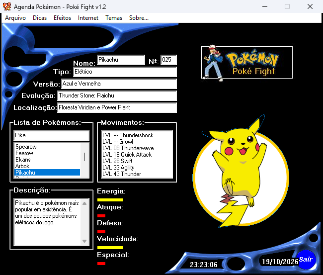

**Português** · [English](en/LEGACY-WIN11.md)

# Rodando o original de 2000 no Windows 10/11



## O diagnóstico

Testado no Windows 11 Pro 64 bits (26200):

* `PokéFight1.2.exe` (PE32, Delphi 3) **abre normalmente**;
* na abertura, `Tinicial.FormActivate` (0x4b94b8) não encontra `c:\windows\data\1.gif`
  e chama `WinExec('press.com', SW_HIDE)`;
* `press.com` é um `.BAT` compilado com BAT2EXEC 1.5, ou seja, **DOS 16 bits**. O Windows
  mostra *"Aplicativo de 16 bits sem suporte"*;
* sem as imagens, a Pokédex abre vazia: sem sprites, sem barras, com avisos de arquivo faltando.

Script recuperado dos `.COM` (o `IMG.COM` é igual, mas com `img.gym`):

```bat
RENAME data.gym data.zip
MD c:\windows\data
GYM data.zip c:\windows\data\      :: GYM.COM = PKUNZJR 2.04c (PKWARE) renomeado
RENAME data.zip data.gym
```

## A correção (`legacy/win11/`)

Duas mudanças, as duas pequenas e reproduzíveis:

### 1. Patch de literais no EXE (`tools/patch_win11.py`)

Só troca **strings** por versões menores; nenhuma instrução do código é alterada.

| Literal | Ocorrências | Antes | Depois |
|---|---|---|---|
| AnsiString (refcount −1 + comprimento) | 331 | `c:\windows\data\025.gif` | `data\025.gif` |
| PChar do `WinExec` (site) | 2 | `c:\arquivos de programas\Internet Explorer\Iexplore.exe www.pokefight.cjb.net` | `explorer.exe http://www.pokefight.cjb.net` |

Nos literais Delphi, o comprimento fica 4 bytes antes do texto. O script ajusta esse
campo, preenche com zeros o espaço que sobra e confere o SHA-256 do EXE de entrada
(`ff860b60…aab295`). O resultado tem SHA-256 `0199f7fa41a3b10e9b75d5871e387d353debf66a49e7241d3e88b6546919ed14`.

### 2. Extrator nativo no lugar dos `.COM` de 16 bits (`tools/gymextract`)

O EXE continua chamando `WinExec('press.com')` e `WinExec('img.com')`. O Windows
executa um programa PE (32/64 bits) **mesmo com extensão `.com`**. Por isso, em
`legacy/win11`, `PRESS.COM` e `IMG.COM` são o `gymextract` (Free Pascal, 64 bits):
ele lê o próprio nome para escolher `DATA.GYM` ou `IMG.GYM` e descompacta em `.\data\`.

O `Gym.com` (PKUNZJR original) fica na pasta só porque o programa verifica se ele
existe (`FileExists('gym.com')`); ele não é mais executado.

## Teste feito

1. pasta limpa com o conteúdo de `legacy/win11`;
2. ao abrir: `data\` recebeu os 6 GIFs das barras (`PRESS.COM` → `DATA.GYM`);
3. ao clicar em **Entrar**: mais 158 GIFs (`IMG.COM` → `IMG.GYM`), 164 no total;
4. busca "Pika": Pikachu com sprite, dados, golpes e barras (captura acima).

## Limitações que continuam

* o programa é 32 bits e não reconhece DPI alto: em telas com escala acima de 100% o
  Windows amplia a janela e ela fica um pouco borrada;
* **E-mail** tenta SMTP no servidor do autor, que não existe mais, e falha;
* **WebSite** abre `www.pokefight.cjb.net`, que está fora do ar
  (há cópias no [Internet Archive](https://web.archive.org/web/2000*/pokefight.cjb.net));
* o programa precisa ser aberto pela própria pasta (diretório de trabalho), como em 2000.
