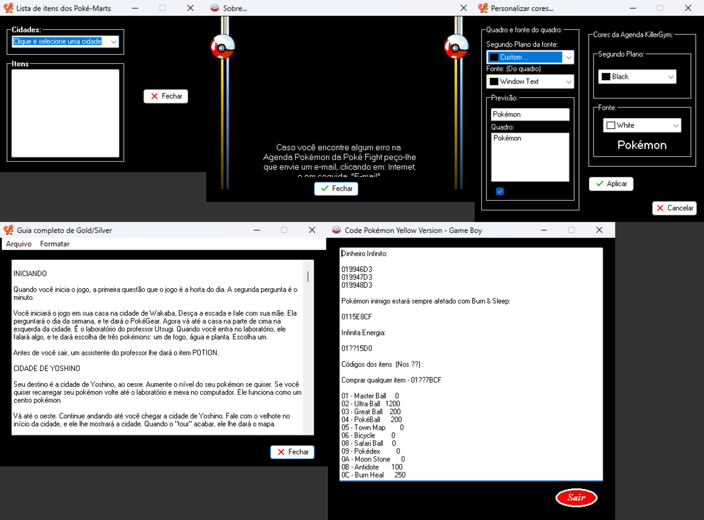

[Português](../RECOMPILACAO.md) · **English**

# The Lazarus recompilation

Goal: a modern executable that **is the same program**, with readable, editable source
code and every decision traceable back to the original binary.

## From binary to source

```
PokéFight1.2.exe
 ├─ RCDATA (14 DFMs)  ── tools/dfm2lfm.py ──────────────► src/*.lfm    (layout, menus, fixed text)
 ├─ VMT/methods       ── analysis/ferramentas/vmt.py ───► address of every event handler
 ├─ code              ── REA + Ghidra (ExportDelphi.java) ► analysis/decompilado/*.c
 │                         └─ extract.py / extract_extras.py ─► analysis/dados/*.json
 │                                └─ tools/gen_pascal_data.py ─► src/upokedados.pas, src/uextras.pas
 └─ DFM blobs         ── tools/ui_assets.py ────────────► assets/ui/ (logos, frames, icons)
```

The handlers were ported by hand from the pseudocode, keeping the original name and the
address in a comment. Example:

```pascal
// 0x4b9df4
procedure TAPKG.ListBox1Click(Sender: TObject);
begin
  if not Imprimir1.Enabled then Imprimir1.Enabled := True;
  if Ligado.Checked then AnimarBarras;
  ...
```

Identifiers and comments in the source are in Portuguese, like the original program.

## Component map

| Original (Delphi 3 + RX Library) | Recompilation (LCL) | Notes |
|---|---|---|
| `TRxGIFAnimator` | `TImage` + `TGifPlayer` (`ugifplayer.pas`) | custom GIF decoder with the RX Library's transparency semantics (see below) |
| `TSecretPanel` (scrolling credits) | `TPanel` + `TPaintBox` | 35 ms per pixel, cyclic, click to pause |
| `TRxTrayIcon` (12 frames) | animated `TTrayIcon` | icons extracted from the DFM |
| `TAppEvents` (minimize/restore) | `OnWindowStateChange` | |
| `TFormStorage` (registry) | `IniFiles` in `%APPDATA%\PokeFightAgenda\agenda.ini` | theme, effects and custom colors |
| `TRxGradientCaption` | — | gradient title bars don't exist on Windows 11 |
| `TColorComboBox` | `TColorBox` | |
| `TRichEdit` / `TRxRichEdit` | `TMemo` | the Gold/Silver guide and cheat-code texts have no formatting |
| `TNMSMTP` (NetMasters) | — | e-mail disabled (server gone) |
| `TMainForm` (RX RTF editor) | `TEditorForm` (plain text, built in code) | see "Editor" below |

## Known (intentional) differences

| Where | Original | Recompilation | Reason |
|---|---|---|---|
| `ListBox1Click` / `Edit1Change` | ~2,200 `if ItemIndex = N` in each | `POKEDEX[]` table + `MostrarEntrada` | same result, readable code |
| Startup | `inicial` is the MainForm and calls `APKG.ShowModal` | modal splash first, `APKG` is the MainForm | in LCL, hiding a modal form to the tray isn't reliable |
| Data install | `press.com`/`img.com` → `c:\windows\data` | `data\` ships already extracted next to the EXE | no 16-bit code, no writes to the Windows folder |
| "Copiar" (Copy) popup | only showed "Copiado!" | actually copies, then shows "Copiado!" | small fix |
| E-mail | SMTP port 25, no authentication, to the author | message explaining | the server is gone |
| WebSite | hardcoded IE path → `www.pokefight.cjb.net` | default browser → Internet Archive | the site is gone |
| Editor → "Pokémon Atual" | pasted the GIF into the RTF document | copies the image to the clipboard | plain-text editor |
| "Personagens" button | `Visible = False`, never shown | `Ctrl+Shift+P` toggles visibility | reveals content hidden since 2000 |
| `Menu` component | name accepted by Delphi | `MenuBandeja` | in FPC a field can't share the name of the `TForm.Menu` property |

Behaviors **kept on purpose**, even though they look like bugs:
* searching animates the stat bars even with Efeitos > Desligado (effects off);
* "Editar / Imprimir" is only enabled after a click in the list (searching doesn't enable it);
* "Atualizar Agenda" only shows "Você não tem autorização…" (you are not authorized);
* the "anti-copy" warning when the PrintScreen toggle state is on;
* searching "Mew" selects Mewtwo (`LB_FINDSTRING` matches by prefix);
* the data keeps the original typos (*Cartepie*, *Arcannine*, the location "Evolução"…).

## Compatibility details

### GIF transparency

The RX Library turned the **color** of the transparent index into a color key. The "Sair"
(Exit) button has an *opaque* black background (index 7) and a transparent index that is
also black (index 0, unused). With the RX Library, all black disappears. A "correct"
decoder would show a black square. `ugifplayer.pas` reproduces the RX rule.

### GroupBox

In Delphi 3, child coordinates start at the GroupBox's outer border; in LCL they start at
the client area. On top of that, the Windows 11 theme ignores the title's font color
(white in the original). `ucomum.AjustarGroupBoxes` redraws the title with a
`TStaticText` and moves the children back to their DFM positions.

### DPI

The project declares *Per-Monitor v2* and `Scaled = True`, so LCL scales the layout,
which was designed for 96 DPI. Testing was done at 100% scaling; at other scales the fine
alignment of the frames may need adjustment.

## Tests performed (Windows 11, 64-bit)

Automated with Win32 messages and screenshots (`PrintWindow`):
splash → Entrar; search ("Pika", "Mew", "Ash"); clicking the list; every menu (TMs,
Poké-Marts, Gold/Silver, Yellow version, About, color customization, Editar / Imprimir →
insert text); themes; `Ctrl+Shift+P` → characters; minimize to tray; settings saved on
close.


